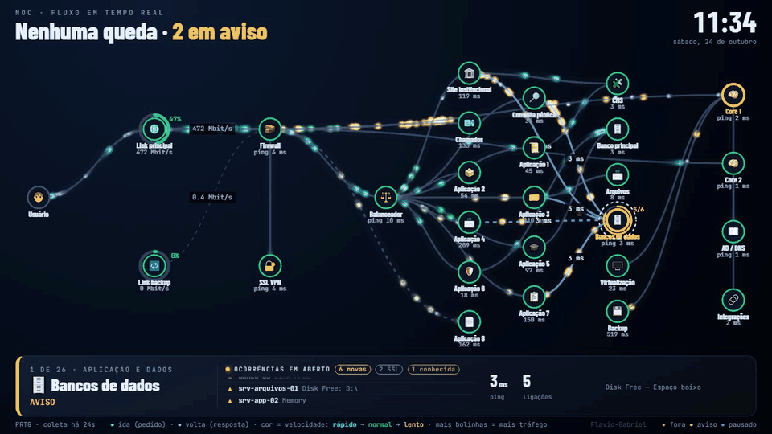
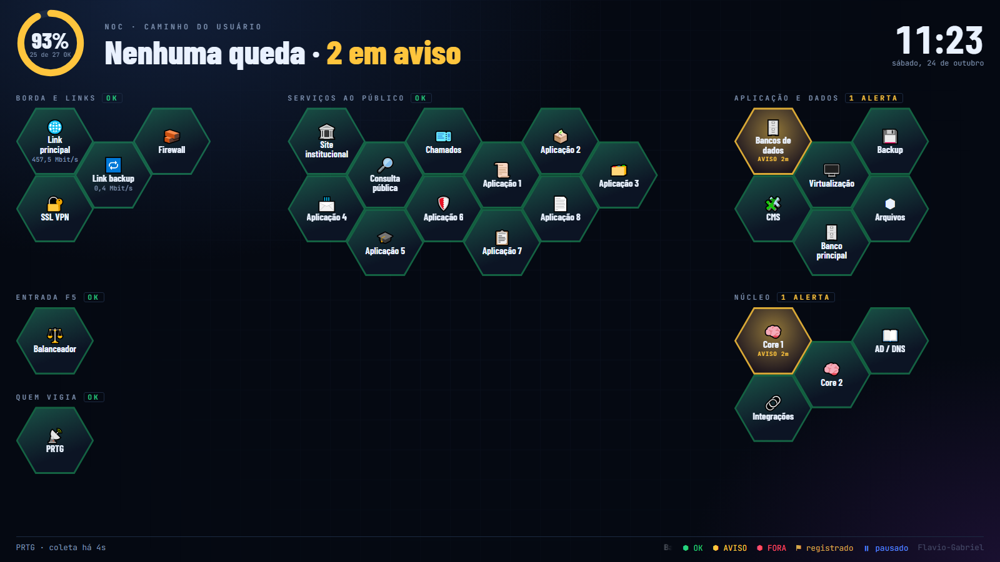
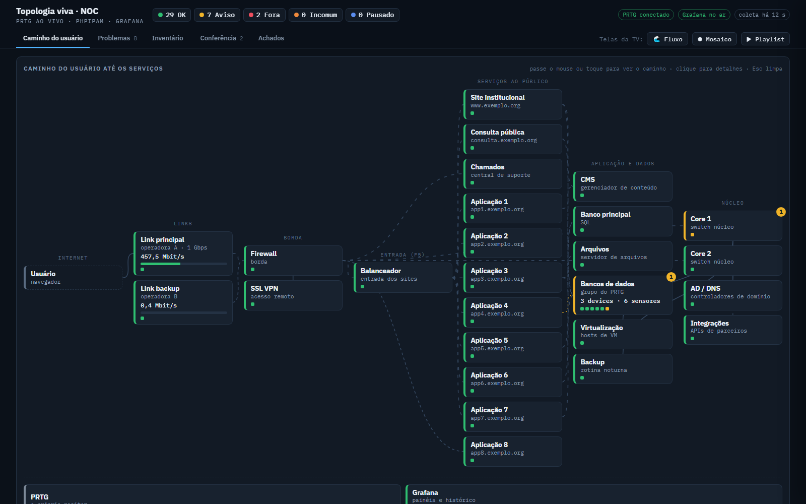
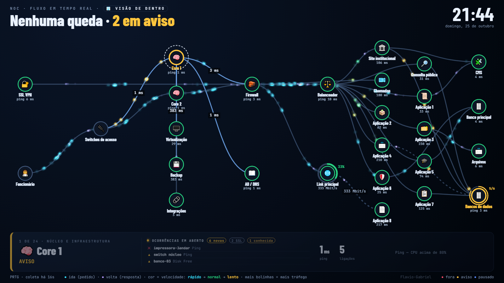

# 🛰️ V2: Topologia viva + telas de NOC para TV

Servidor pequeno em Python (sem dependências externas) que lê o PRTG em segundo plano e entrega:

| Tela | Endereço | O que mostra |
|---|---|---|
| Topologia | `/` | Mapa do caminho do usuário até os serviços, com estado de cada item e links para o Grafana |
| Fluxo | `/fluxo` | Animação para TV: bolinhas andando pelas ligações (ida e volta), cor e velocidade pelo tempo de resposta, cartão automático por serviço e lista de ocorrências em aberto |
| Mosaico | `/mosaico` | Colmeia de hexágonos, um por serviço, para leitura de longe |
| Playlist | `/fluxo?playlist` | Alterna sozinho entre Fluxo e Mosaico (`&t=120` = segundos por tela) |

A chave do PRTG **nunca vai para o navegador**: só o servidor fala com o PRTG.



| Mosaico | Topologia |
|---|---|
|  |  |

**Visão de dentro** (`/fluxo?visao=dentro`): o caminho de quem está na rede interna.


*Prints feitos no modo demonstração, com dados fictícios.*

## Como funciona
```
PRTG ──(a cada 60 s)──> servidor.py ──(/api/snapshot a cada 20 s)──> telas no navegador/TV
   ▲                        │
   └──── /prtg/api/... ─────┘  intermediário com fila (4 em paralelo), novas tentativas e cache
                               usado pelo Grafana: acaba com os erros intermitentes 401/400
```
- **Intermediário para o Grafana:** o PRTG falha quando recebe muitas consultas ao mesmo tempo. O Grafana passa a consultar `http://<servidor>:8090/prtg/api/...`, que enfileira, repete em caso de 4xx/5xx/timeout e guarda em cache (histórico 300 s, o resto 30 s). Só leitura; endpoints fora da lista são recusados.
- **Telas sempre sincronizadas:** a resposta do servidor carrega uma `versao` (data dos arquivos). Se alguém editar uma tela, todas as TVs abertas recarregam sozinhas. Se o login expirar, a tela pede de novo em vez de congelar; dados com mais de 3 ciclos ficam marcados como "⚠ dados atrasados".
- **Vigia (`vigia.pyw`):** roda sem janela, confere o servidor a cada 10 s e reinicia se ele cair ou parar de responder por 30 s.

## Visão de fora e visão de dentro
- **De fora** (padrão): usuário na internet → links → firewall → balanceador → serviços → dados.
- **De dentro** (`?visao=dentro`, na Topologia e no Fluxo): funcionário → switches de acesso → núcleo (com virtualização e backup) → firewall entre VLANs e DNS interno → balanceador ou saída para a internet → sistemas → dados.
- As duas usam **os mesmos sensores**; muda só o arranjo, definido em `config.json` → `dentro` (`camadas`, `nos` com a camada de cada item, `novos` e `ligacoes`).
- Um botão no topo de cada tela troca de visão. A playlist da TV alterna **fora → dentro → mosaico**.

## Regras visuais do Fluxo
- **Cor = velocidade**, escala logarítmica: `t = (ln(ms) − ln 30) / (ln 300 − ln 30)`, limitada a [0, 1]. 30 ms ou menos é ciano (rápido), cerca de 95 ms é verde (normal), 300 ms ou mais é amarelo (lento). Logarítmica porque dobrar de 20→40 ms pesa tanto quanto de 200→400 ms.
- **A velocidade da bolinha sai da mesma decisão da cor**, em pixels por segundo (240 rápido → 60 lento), sem depender do comprimento do trecho. Aviso conta como lento: amarelo nunca corre mais que ciano.
- **Tempo = mediana das 3 últimas medições** (robôs e sensores HTTP): o servidor busca o histórico curto a cada coleta. Um pico isolado não muda a cor; aparece só como nota no cartão ("última: 593 ms (pico)"). Queda e alerta vêm direto do status do PRTG, sem esperar a mediana.
- **Tempo por item:** usa o sensor principal; se não houver, o menor tempo HTTP, e só por último o ping (mostrado como "ping X ms").
- **Ocorrências em aberto:** sensores em Aviso, Fora do ar, Fora (reconhecido) ou Parcial. "Incomum" fica de fora (é só desvio estatístico), avisos de SSL viram uma linha só e os itens listados em `conhecidos` viram um resumo.

## Rodar
**No PC (teste):**
```bash
cp config.exemplo.json config.json      # edite com os IDs dos seus sensores
set TOPO_PRTG_APIKEY=<chave-de-LEITURA-do-PRTG>
set PRTG_URL=https://<seu-prtg>
python servidor.py                      # http://localhost:8090
```
Login opcional: `TOPO_USUARIO` + `TOPO_SENHA_SHA256`, ou um arquivo `acesso.txt` com `usuario:sha256`.

**Em container (recomendado para produção):**
```bash
cd deploy
cp .env.example .env    # preencha: URL e chave de LEITURA do PRTG, senhas
docker compose up -d    # Grafana + Topologia, com reinício automático e checagem de saúde
```
Use Docker Engine numa VM Linux. O Docker Desktop exige licença paga em empresas e órgãos públicos.

## Modo demonstração (sem PRTG)
Para ver as telas funcionando sem ter um PRTG, ou para tirar prints sem expor dados reais:
```bash
set TOPO_DEMO=1
python servidor.py        # usa config.exemplo.json e dados fictícios que variam a cada coleta
```
Abra `http://localhost:8090/fluxo`. Acrescente `?print` ao endereço para desligar as transições (útil em capturas automáticas).

### Painéis de demonstração do Grafana
Em `deploy/grafana/demo/` estão três painéis (NOC, Serviços ao público, Firewall) prontos para importar.
1. Rode o servidor com `TOPO_DEMO=1`.
2. No Grafana, crie uma fonte de dados **Infinity** com uid `prtg-demo` e *Allowed hosts* = endereço do servidor.
3. Importe os JSON (**Dashboards → New → Import**) e troque `http://topologia:8090` pelo endereço do servidor, se for diferente.

O modo demo responde aos mesmos formatos do PRTG que os painéis usam: `table.json`, `status.json`, `historicdata.csv` e `historicdata.json`.

## `config.json`
| Campo | Para quê |
|---|---|
| `camadas` | Colunas da tela, da esquerda (Internet) para a direita (Núcleo) |
| `nos` | Itens: `id`, `rotulo`, `sub`, `camada`, `sensores` (IDs do PRTG), `grupoNome` (soma um grupo inteiro), `capacidadeMbit` (links) ou `fixo` (sem sensor) |
| `ligacoes` | `[origem, destino, tipo]`; o tipo é `rede`, `reserva`, `externo` ou `hipotese` |
| `conhecidos` | `{ "id-do-sensor": "motivo" }`: problemas já sabidos, mostrados à parte |
| `grafana` | Atalhos para os painéis |

O servidor recarrega o arquivo sozinho quando ele muda.

## Segurança
- Use uma chave de API **somente leitura**, de uma conta de serviço.
- `config.json`, `acesso.txt`, `.env` e logs estão no `.gitignore`: eles contêm dados da sua rede.
- Coloque HTTPS na frente (proxy reverso ou balanceador) antes de abrir para a rede.

---
Feito por **Flavio-Gabriel**.
